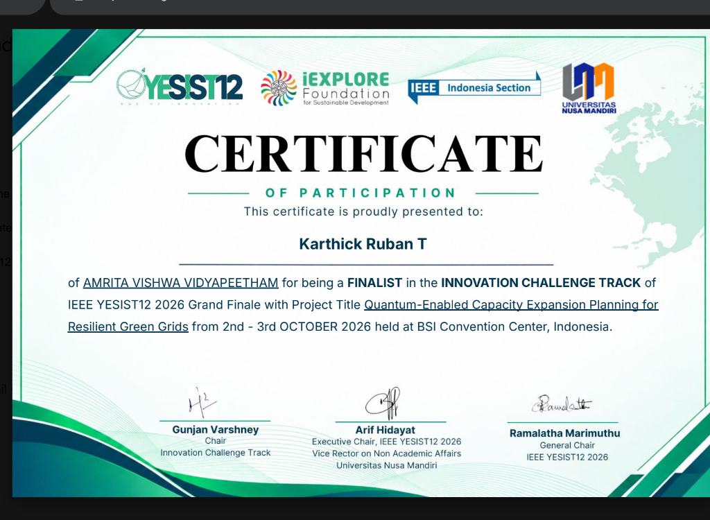

# ⚡ Quantum-Enabled Capacity Expansion Planning for Resilient Green Grids (Q-CEP)

<p align="center">
  
  
  
  
  
</p>

A quantum-classical optimization workflow that selects non-uniformly weighted representative operating days via **QUBO $\rightarrow$ QAOA (Quantum Approximate Optimization Algorithm)** and integrates them into a **PyPSA-based capacity expansion model** to compress temporal dimensionality while preserving investment planning cost fidelity.

---

## 🏆 International Recognition & Award

<p align="center">
  
</p>

> **Finalist in the Innovation Challenge Track — IEEE YESIST12 2026 Grand Finale**  
> *Presented to **Karthick Ruban T** (Amrita Vishwa Vidyapeetham) at the Grand Finale held at BSI Convention Center, Indonesia (October 2nd–3rd, 2026).*

---

## 👥 Authors & Research Group

* **Karthick Ruban T** ([@Karthickruban](https://github.com/Karthickruban)) — **Project Lead & Core Implementation**  
  *Department of Artificial Intelligence and Data Science, Amrita Vishwa Vidyapeetham, Coimbatore*

---

## 📌 Context & Problem Statement

Modern power system planning requires high-resolution temporal data to capture variability in load and renewable resources (solar, wind, hydro). However, full-year 8,760-hour simulations are computationally prohibitive. 

**Q-CEP (Quantum-Enabled Capacity Expansion Planning)** solves this by:
1. Posing representative-day selection as a **QUBO (Quadratic Unconstrained Binary Optimization)** problem.
2. Solving with **QAOA (Quantum Approximate Optimization Algorithm)** to identify the most informative operating conditions.
3. Applying **non-uniform weights** derived from cluster memberships to preserve renewable curtailment and ramping dynamics.
4. Feeding the reduced time series into **PyPSA (Linear Optimal Power Flow - LOPF)** for rapid, cost-optimal generation and transmission expansion.

Across standard benchmark networks (**IEEE 9-bus**, **IEEE 30-bus**, and **IEEE 118-bus**), the approach achieves a **>60% reduction in temporal dimensionality** while holding system cost deviations to **$\approx 4.5\%$**.

---

## 📊 Workflow Architecture

<p align="center">
  
</p>

1. **Preprocess:** Ingest hourly load, wind, and hydro datasets; normalize into diurnal feature profiles.
2. **Seasonal Windowing & PCA:** Partition seasons into half-month windows to keep each sub-QUBO tractable for current quantum simulators ($\approx 2^{15}\!-\!2^{16}$ Hilbert space).
3. **QUBO Formulation & QAOA:** Formulate medoid distance minimization as a QUBO and optimize parameters $\gamma, \beta$ using classical optimizers (COBYLA).
4. **Non-Uniform Weighting:** Scale cluster representatives by assigned day frequencies.
5. **PyPSA CEP Simulation:** Execute capacity expansion planning with weighted representative snapshots.
6. **Validation:** Compare against full 8,760-hour baseline dispatches for capital cost fidelity and line congestion.

---

## 🔬 Experiments & Evaluation Presets

The repository includes reproducible experimental configurations:

- **Experiment 1 ($k = 2$):** 12 representative days per season — [`experiment_1.py`](experiment_1.py)
- **Experiment 2 ($k = 3$):** 18 representative days per season — [`experiment_2.py`](experiment_2.py)
- **Experiment 3 ($k = 4$):** 24 representative days per season — [`experiment_3.py`](experiment_3.py)
- **Sensitivity Analysis ($k = 3$):** Evaluates QAOA circuit depth ($p \in \{1, 2, 3\}$), angle initializations, and convergence limits — [`sensitivity_analysis.py`](sensitivity_analysis.py)

---

## ⚡ Quickstart & Setup

### 1. Clone the Repository

```bash
git clone https://github.com/Karthickruban/Quantum-Enabled-Capacity-Expansion-Planning.git
cd Quantum-Enabled-Capacity-Expansion-Planning
```

### 2. Environment Setup

```bash
# Create and activate virtual environment
python3 -m venv venv
source venv/bin/activate  # On Windows: venv\Scripts\activate

# Install dependencies
pip install -r requirements.txt
```

### 3. Run Experiments

```bash
# Run baseline experiment with k=3 (18 representative days)
python experiment_2.py

# Run QAOA parameter sensitivity sweep
python sensitivity_analysis.py
```

---

## 📚 Academic Reference & Citation

This implementation builds upon research in quantum-assisted power systems modeling:

```bibtex
@article{Singha2025_QuantumAggregation,
  title   = {Application of quantum computing to temporal aggregation for efficient capacity expansion in power systems},
  author  = {Singha, Ankana and Mishra, Sambeet and Shafie-khah, Miadreza},
  journal = {International Journal of Electrical Power & Energy Systems},
  year    = {2025},
  volume  = {173},
  pages   = {111355},
  doi     = {10.1016/j.ijepes.2025.111355}
}
```

---

## 📄 License
This project is open-source and licensed under the [MIT License](LICENSE).
